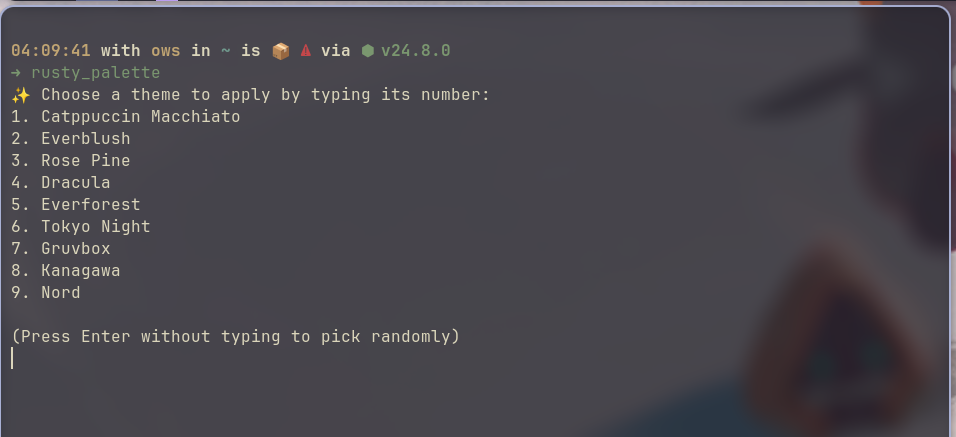

# **Rusty Palette** ✨

A Rust **CLI** tool for applying a set of themes and wallpapers to your system and apps via a configuration file.



## **Overview** 🌟

**Rusty Palette** applies visual customizations from JSON configs, including:

1. Setting wallpapers.
2. Changing the following app themes
   - FreeTube
   - Vesktop
   - Neovim
   - Alacritty
   - Btop
   - Rofi
   - Vscodium
   - OpenCode
3. Customizing Papirus Folder colors.

---

## **Pre-Requisites** 🔧

1. **Rust**: Install `rustup` to compile and run. [Install Rust](https://www.rust-lang.org/tools/install).

2. **Papirus icons**: Install the [Papirus icon theme](https://github.com/PapirusDevelopmentTeam/papirus-icon-theme) into `~/.local/share/icons/`. `Papirus-Dark` and `Papirus-Light` are symlinked into `Papirus`, so the base theme is installed along with them:

   ```bash
   git clone --depth 1 https://github.com/PapirusDevelopmentTeam/papirus-icon-theme.git /tmp/papirus-icon-theme
   mkdir -p ~/.local/share/icons
   cp -r /tmp/papirus-icon-theme/Papirus /tmp/papirus-icon-theme/Papirus-Dark /tmp/papirus-icon-theme/Papirus-Light ~/.local/share/icons/
   rm -rf /tmp/papirus-icon-theme
   ```

3. **Feh**: Install `feh` for setting wallpapers.

This command should install both packages above if you're using an arch-based system:

   ```bash 
   yay -S rustup feh --noconfirm && rustup default stable
   ```

---

## **How to Use** 🚀

1. **Install**:

   ```bash
   curl -fsSL https://raw.githubusercontent.com/O-ELMA/rusty_palette/master/install | bash
   ```

   Or from a clone:

   ```bash
   git clone https://github.com/O-ELMA/rusty_palette.git && cd rusty_palette && bash ./install
   ```

2. **Run the Program**:

   ```bash
   rusty_palette
   rusty_palette Tokyo Night #mentioninig the name of the theme will set it for you
   ```

3. **Uninstall**:

   Run the uninstall script

   ```bash
   bash ./uninstall
   ```
---

## **Configuration** ⚙️

The tool uses two configuration files:

1. **`bin/config/apps.toml`**: Specifies apps to customize and tells the code how to customize them. Do not touch it unless you know what you're doing.
2. **`bin/config/themes.toml`**: Contains theme names with wallpapers. Feel free to set the wallpaper paths there for each theme.
